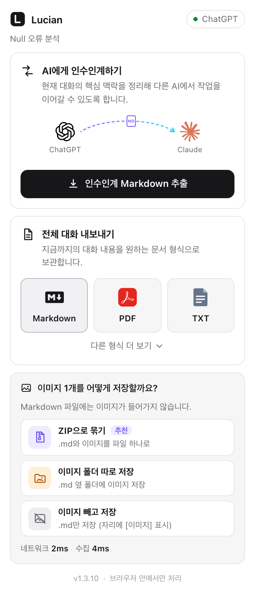

# Lucian AI Chat Exporter

[](https://github.com/Seokwoooo/lucian-ai-chat-exporter/actions/workflows/ci.yml)


ChatGPT·Claude·Gemini·Grok 대화를 **한 번의 클릭으로 다른 AI에게 인수인계**하거나, **전체 대화를 PDF·Markdown·Word·한글(HWPX) 등으로 내보내는** Chrome 확장 프로그램입니다.

모든 처리는 브라우저 안에서 끝납니다. 대화 내용을 외부 서버나 AI로 보내지 않고, 회원가입도 설정도 없습니다.

[English](#english) · [설치](#설치) · [기능](#두-가지-기능) · [지원 범위](#지원-범위) · [개인정보](#개인정보) · [한계](#알려진-한계) · [개발](#개발)

| 답변 아래 Lucian 버튼 | 툴바 팝업 | 다른 형식 펼침 (다크 모드) |
|---|---|---|
|  |  |  |

**두 곳에서 실행할 수 있습니다.** 답변이 끝나면 각 답변 아래 도구 막대(복사·다시 생성 버튼 옆)에 은은한 보라·청록 빛 링이 도는 Lucian 버튼이 나타나고, 브라우저 툴바의 Lucian 아이콘으로도 같은 기능을 엽니다. 어느 쪽에서 시작해도 같은 작업이며, 진행 상황(“처리 중… (n% 완료)”)과 결과가 양쪽에 보입니다.

---

## 두 가지 기능

### 1. AI에게 인수인계하기 — `인수인계 Markdown 추출`

버튼 하나로 `대화-제목-lucian-handoff-2026-10-18.md` 같은 파일이 저장됩니다. 파일 이름 앞에는 대화 제목이 붙어 어느 대화의 인수인계인지 바로 알 수 있습니다(v1.3.5). 이 파일을 다른 AI(다른 서비스나 새 대화)에 첨부하면 그 AI가 작업을 바로 이어받을 수 있습니다. 버튼 위의 작은 그림(지금 쓰는 서비스 로고 → 곡선 화살표 → 다른 서비스 로고)이 이 흐름을 보여 줍니다.

- 문서 맨 위에 **읽는 AI를 위한 안내문**이 있습니다. 이어서 기본 정보, 목표와 요청 흐름(처음 요청 + 이후 요청을 시간순으로, 긴 대화는 각 답변의 요지 한 줄과 함께), 첨부 자료, 확정된 결정(최신 기준), 지시·제한·금지사항, 완료한 작업, 현재 상태, 미완료 문제, 다음 작업, 실패 원인, 핵심 코드·파일, 참고 링크, 중요한 맥락(원문 발췌), 최근 원문 순으로 정리됩니다. 내용이 없는 섹션은 넣지 않습니다. 짧은 대화는 섹션 대신 **대화 원문에서 핵심 문장만 남긴 형식**입니다(아래).
- **추출식 정리입니다.** LLM, 임베딩, 외부 API를 쓰지 않는 규칙 기반 TypeScript가 원문 문장을 그대로 발췌합니다. 그래서 없던 사실을 만들어 내지 않습니다. 모든 항목에는 원문 위치 `[#m12]`가 붙습니다.
- 결정이 바뀌면 최신 결정을 우선하되, 이전 결정도 지우지 않고 남깁니다. 키워드만으로 바뀌었다고 단정하지 않고, 확신할 수 없는 항목은 ⚠️로 표시합니다.
- **인수인계 파일은 같은 대화의 전체 추출보다 항상 작습니다 (v1.3.8).** 분량은 전체 추출(Markdown) 크기의 약 12%(8k–32k 토큰)이고, 어떤 대화든 전체 추출의 2/3를 넘지 않습니다. 섹션마다 토큰 몫을 정해 중요도 순으로 채우고, 마지막에 크기를 재서 넘으면 줄입니다.
  - 이전에는 1만 2천 토큰 이하 대화에 원문 전체를 넣고 그 위에 안내문과 섹션을 더 붙여서, "압축" 파일이 전체 추출보다 29–38% 컸습니다(사용자 보고). 이제 짧은 대화(전체 추출 약 6천 토큰 미만)는 **대화 원문에서 핵심 문장만** 순서대로 남기고, 생략한 곳은 `…`로 표시합니다. 짧은 명령어·코드 블록은 그 앞 문장과 함께 남깁니다. 같은 분량에서 섹션 형식보다 실제 대화의 정보가 더 많이 남았습니다(보존 점수 59.5–81.3 → 85.3–88.0).
  - 토큰 수는 실제 토크나이저(OpenAI o200k)와 ±7% 안으로 맞춘 추정치로 셉니다. 이전 규칙("한글 1자 1토큰, 나머지 4자 1토큰")은 `[#m12]`·표 같은 마크업을 절반쯤으로 세서, 인수인계 문서가 실제보다 작게 보였습니다.
- **같은 분량에 더 많은 정보를 담습니다.** 남은 예산은 "예산 제약 최대 커버리지"로 채웁니다. 문서에 아직 없는 개념(단어·단어쌍)을 토큰당 가장 많이 새로 담는 원문 문장부터 고르는 방식입니다. 아주 긴 메시지는 원문 섹션에서 앞뒤만 보여 주고, 잘린 가운데의 문장·표도 같은 조건으로 고릅니다. 사용자의 실제 ChatGPT 대화 27개(약 152만 토큰)로 알고리즘 19가지를 비교해 정했습니다. v1.1보다 출력이 9% 짧으면서 핵심어 보존은 82% → 88%, 사실 문장 보존은 25% → 29%로 올랐습니다. "그래서…", "이 방식은…"처럼 앞 문장이 있어야 이해되는 문장은 앞 문장과 함께 넣습니다. 최신 방법(KL-Sum, facility location, CliffCompaction 등)과 오픈 모델(EmbeddingGemma 2, LLMLingua-2)도 비교했지만, 같은 분량에서 더 나으면서 브라우저에서 가볍게 돌아가는 방법은 없었습니다. v1.3에서는 "문서만 받은 AI가 질문에 맞게 답하는가"를 합성 대화로 직접 재서 분량 배분을 다시 정했습니다. 기본 예산에서 정답률이 78.8% → 97.6%가 됐고 문서는 더 짧아졌습니다(실제 대화 31개에서는 사실 문장 보존 29.7% → 33.2%, 출력 −7%). 자세한 내용은 [압축 실험 보고서](docs/compression-lab.md)에 있습니다.
- **잡음을 넣지 않습니다.** 웹 검색 답변에 딸린 수십~수백 개의 검색 결과 링크, 추적 파라미터(`utm_source` 등), 출처 칩, 서비스의 화면용 마크업은 빼고, 같은 문장은 한 섹션에만 넣습니다. 거의 같은 요청이 반복되면 한 줄로 묶고 횟수를 적습니다. 링크는 같은 페이지를 하나로 합쳐 많이 언급된 순으로 보여 줍니다.
- **첨부한 파일과 붙여넣은 글도 넣습니다 (v1.3.5).** "아래 글 어떻게 생각해?"처럼 첨부한 내용에 대한 요청은 그 첨부가 없으면 다음 AI가 이해할 수 없습니다. 대화 기록에 텍스트가 있는 첨부(붙여넣은 긴 글, 텍스트 파일)는 「첨부 자료」 섹션에 원문 그대로 넣습니다. 처음 요청과 마지막 요청의 첨부를 먼저 넣고, 예산의 12%를 넘으면 앞뒤만 넣습니다. 내용이 텍스트로 없는 파일(PDF, 이미지 등)은 이름만 적고, 다음 AI가 사용자에게 다시 첨부해 달라고 하도록 안내합니다.
- **고쳐 쓴 초안은 한 번만 넣습니다 (v1.3.4).** "다시 써줘"를 여러 번 해서 같은 글이 조금씩 바뀌며 반복되면, 원문 섹션에는 마지막 판만 전부 남기고 앞 판에서는 바뀐 줄만 남깁니다. 나머지는 `_(… N줄 생략 — 같거나 거의 같은 내용이 아래 [#mK]에 있습니다)_` 한 줄이 됩니다. 이 안내가 지운 줄보다 길면 줄을 그대로 두고, 표의 줄은 지우지 않습니다(머리글이 빠진 표는 표가 아니므로, v1.3.8). 핵심 문장 형식에서는 같은 문장의 앞 판을 넣지 않습니다.
- **저장되면 항상 “인수인계 파일 저장 완료”로 표시합니다 (v1.3.8).** 일부 메시지를 읽지 못하는 등 작은 문제가 있어도 파일은 저장되어 바로 쓸 수 있으므로 ✓로 보여 주고, 무엇이 문제였는지는 접힌 **세부 정보**에 적습니다(읽지 못한 메시지는 사용자/AI 답변과 서비스의 내용 형식까지). 파일을 아예 만들거나 저장하지 못했을 때만 실패로 표시합니다.
- 성능: 1M 토큰(4,514개 메시지) 대화의 문서 생성 시간이 **1.16초**입니다(데이터 확보 → Markdown 완료, Chrome 155, M2 Pro). 같은 대화를 다시 만들 때는 분석 캐시를 써서 **0.85초**입니다. (v1.3.8에서 토큰을 실제에 가깝게 세면서 같은 "1M 토큰" 합성 대화가 20% 길어졌습니다. 이전 기록은 3,782개 메시지에 0.72초였습니다.) 네트워크·수집·생성·저장 시간은 팝업에 따로 표시됩니다.

### 2. 전체 대화 내보내기

| 기본 | `다른 형식 더 보기 ˅` |
|---|---|
| **Markdown** · **PDF** · **TXT** | **Word (.docx)** · **한글 (HWPX)** · HTML · JSON · **ZIP 전체 백업** |

v1.3.7부터 Markdown이 맨 앞에 오고, Word는 “다른 형식 더 보기” 안으로 옮겼습니다. 버튼에는 각 형식의 로고가 붙습니다(PDF·Word 로고는 Adobe·Microsoft의 상표이며 파일 형식을 가리키는 용도로만 씁니다).

- ChatGPT 답변의 코드 블록(복사 버튼이 붙은 명령어 등)이 모든 문서와 인수인계에서 빠지던 문제를 고쳤습니다(v1.3.9).
- **서비스가 요청을 잠시 막아도 화면을 스크롤하지 않습니다 (v1.3.10).** 긴 대화를 짧은 시간에 여러 번 내보내면 ChatGPT가 `429`(요청 과다)와 함께 “35초 뒤 다시”를 돌려줍니다. 전에는 4.5초 만에 포기하고 화면을 스크롤하며 읽어서 약 40초가 걸리고 메시지가 빠졌습니다(실제 대화에서 42개 중 16개만 남음). 이제 화면에 보이는 마지막 메시지까지 앞서 받아 둔 사본에 다 들어 있으면 기다리지 않고 그 사본으로 바로 만듭니다(경고 없음, 고를 것도 없음). 아니면 서비스가 알려 준 시간만큼 기다렸다 다시 받고(팝업·패널에 남은 초 표시), 그래도 막히면 사본으로 만들고 “n분 전 사본”이라고 알립니다. 사본도 없으면 몇 초 뒤에 다시 하라고 안내합니다. 화면은 서비스 응답 형식이 바뀌어 읽을 수 없을 때만 읽습니다.
- 문서 머리말과 인수인계 「기본 정보」의 원본은 `chatgpt.com`, `grok.com`처럼 **사이트 주소로만** 적습니다. 모델 이름(`grok-4` 등)은 문서에 넣지 않고 JSON 백업에만 남깁니다(v1.3.8).
- **PDF**: Chrome의 인쇄 엔진으로 내 컴퓨터에서 만듭니다. 인쇄 창의 대상에서 “PDF로 저장”을 고르면 됩니다. 한글 글꼴, 표, 코드, 수식, 이미지가 그대로 나오고, 외부 PDF 서버는 쓰지 않습니다.
- **Markdown과 이미지 (v1.3.6)**: Markdown 파일 자체에는 이미지를 넣을 수 없습니다. 서비스의 이미지 주소는 그 서비스에 로그인한 브라우저에서만 열리기 때문에(로그인 없이 열면 거부됨), 링크만 남기면 다른 프로그램에서는 이미지가 보이지 않습니다. 그래서 이미지가 있는 대화를 Markdown으로 내보내면 매번 고르게 합니다.
  - **ZIP으로 묶기 (추천)**: `.md`와 `images/` 폴더를 ZIP 하나로 저장합니다. 압축을 풀면 Obsidian·VS Code·GitHub 등 어디서나 이미지가 보입니다.
  - **이미지 폴더 따로 저장**: `.md` 옆에 `제목_files/` 폴더를 만들어 이미지를 저장합니다(Chrome의 "웹페이지 전체 저장"과 같은 방식). 이미지마다 다운로드가 하나씩 생기고, Chrome에서 저장 위치를 매번 묻게 해 두었다면 창이 여러 번 뜹니다.
  - **이미지 빼고 저장**: `.md`만 저장하고 이미지 자리에는 `[이미지: 설명]`만 남깁니다.

  v1.3.7에서 이 화면을 짧게 고쳤습니다. 경고 대신 질문(“이미지 1개를 어떻게 저장할까요?”)으로 묻고, 선택지마다 아이콘과 한 줄 설명만 둡니다.

  
- **HWPX**: 직접 생성한 OWPML 패키지입니다. 확장자만 바꾼 파일이 아니며, 공식 OWPML XSD 스키마 검증을 통과합니다.
- **ZIP 전체 백업**: `conversation.md/html/json`, `images/`, `attachments/`, `verification-report.md/json`을 담습니다. 받지 못한 이미지·첨부는 보고서에 명시합니다.
- 내보낼 때마다 **검증 결과**를 보여 줍니다. 원본 메시지 수 대비 추출 수, 이미지 포함 여부, 첨부 저장 여부, 수식 렌더링, 파일 무결성(ZIP·XML 파싱, 다운로드 크기 일치)을 확인하고, 빠진 것이 있으면 경고나 실패로 표시합니다.
- 문서의 출처 목록에는 **답변이 실제로 인용한 출처**만 넣습니다. 검색만 하고 인용하지 않은 결과는 JSON·ZIP 백업에 보존하고, 그 사실을 검증 결과에 적습니다.
- 팝업을 닫아도 작업은 계속됩니다(서비스 워커와 offscreen 문서에서 처리).

---

## 설치

### 릴리스 ZIP으로 설치 (개발자 모드)

1. [Releases](https://github.com/Seokwoooo/lucian-ai-chat-exporter/releases)에서 `lucian-ai-chat-exporter-v1.3.10.zip`을 받아 압축을 풉니다.
2. Chrome 주소창에 `chrome://extensions`를 입력합니다.
3. 오른쪽 위 **개발자 모드**를 켭니다.
4. **압축해제된 확장 프로그램을 로드합니다**를 누르고, 압축을 푼 폴더(`manifest.json`이 있는 폴더)를 고릅니다.
5. ChatGPT·Claude·Gemini·Grok의 대화 화면을 **새로고침**합니다. 답변 아래의 Lucian 버튼이나 툴바의 Lucian 아이콘을 누르면 됩니다.

이전 버전에서 업데이트할 때는 `chrome://extensions`에서 Lucian의 새로고침(↻) 버튼을 누른 뒤, 열려 있던 대화 탭도 새로고침해 주세요.

### 소스에서 빌드

```bash
git clone https://github.com/Seokwoooo/lucian-ai-chat-exporter.git
cd lucian-ai-chat-exporter
npm ci
npm run build      # dist/ 폴더를 위 4단계에서 선택
```

Chrome 116 이상이 필요합니다.

---

## 지원 범위

| | ChatGPT | Claude | Gemini | Grok |
|---|---|---|---|---|
| 수집 방식 | 내부 API + DOM 대체 경로 | 내부 API + DOM 대체 경로 | batchexecute + DOM 대체 경로 | REST + DOM 대체 경로 |
| 텍스트·코드·표·목록 | ✅ | ✅ | ✅ | ✅ |
| 수식 | ✅ (PDF·HTML: 렌더링 / DOCX·HWPX·TXT: LaTeX 원문) | ✅ | ✅ | ✅ |
| 이미지 | ✅ 업로드·생성 이미지 | ✅ 업로드 이미지 미리보기 | ✅ | ✅ 생성·첨부 이미지 |
| 첨부파일 원본 (ZIP) | ✅ 파일 API | △ URL이 있을 때만, 없으면 추출 텍스트 | ❌ 이름 정보만 | △ URL이 있을 때만 |
| 캔버스·아티팩트 | ✅ Canvas | ✅ Artifacts | — | — |
| 출처·인용 | ✅ | ✅ 웹 검색 | ❌ 파싱 안 함 | ✅ |
| 사고 과정(Thinking) | JSON·ZIP에만 보존 | JSON·ZIP에만 보존 | ❌ 파싱 안 함 | JSON·ZIP에만 보존 |
| 다른 답변 분기 | JSON·ZIP에 보존 | JSON·ZIP에 보존 | — | JSON·ZIP에 보존 |
| 긴 대화 | ✅ | ✅ | ✅ 페이지 단위 수집 | ✅ |
| 답변 아래 Lucian 버튼 | ✅ | ✅ (예전 답변은 마우스를 올렸을 때) | ✅ | ✅ |

- ✅는 단위 테스트, 그리고 모의 사이트에 대한 E2E로 확인했다는 뜻입니다. 실제 서비스에서 무엇을 확인했는지는 [테스트 보고서](docs/test-report.md#6-실제-서비스-확인)에 정리했습니다.
- 지원 사이트가 아닌 페이지에서는 버튼이 비활성화되고 안내가 표시됩니다.
- 공유 링크(`/share/...`)와 대화 목록 페이지는 대상이 아닙니다. 대화를 연 화면에서 사용하세요.

---

## 개인정보

- 대화는 **사용자의 브라우저 안에서만** 처리됩니다. 분석 서버, 외부 AI, 통계 도구가 없습니다.
- 로그인 정보, 쿠키, 인증 토큰을 **디스크에 저장하지 않습니다.** 서비스 페이지가 쓰는 인증 헤더는 그 탭의 메모리에서만 요청에 사용합니다.
- 수집한 대화, 이미지, 인수인계 분석 캐시는 이 컴퓨터의 IndexedDB(`lucianDB`)에만 저장됩니다. 7일이 지나면 삭제되고(브라우저 시작 시와 작업 시작 시 정리), 이미지 캐시는 최근 500개까지만 유지합니다.
- 인증을 우회하거나 보안 기능을 무력화하지 않습니다. 사용자가 이미 볼 수 있는 대화만 읽습니다.
- 자세한 내용: [개인정보처리방침 초안](docs/privacy-policy.md) · [권한 설명](docs/permissions.md)

---

## 알려진 한계

솔직하게 적습니다. 자세한 내용은 [테스트 보고서](docs/test-report.md)에 있습니다.

- **실제 계정에서 확장 프로그램 전체 흐름은 검증하지 못했습니다.** 실제 사이트 4곳에서는 로그인된 브라우저로 내부 API의 응답 구조와 DOM 구조만 읽기 전용으로 확인했습니다. 설치 → 클릭 → 다운로드까지의 흐름은 모의 사이트 E2E로만 검증했습니다.
- 각 서비스의 내부 API와 화면 구조는 예고 없이 바뀔 수 있습니다. API 응답 형식을 읽지 못하면 화면(DOM)에서 읽는 대체 경로를 쓰고, 그 사실을 검증 결과에 경고로 남깁니다. 요청이 막히거나(429) 로그인·네트워크 문제로 실패하면 화면을 읽지 않고, 저장된 사본을 쓰거나 오류를 알립니다(v1.3.10).
- PDF는 인쇄 창에서 사용자가 “PDF로 저장”을 직접 골라야 합니다. 브라우저 확장이 PDF 파일을 바로 저장하는 안정적인 로컬 방법이 없기 때문입니다.
- Word·HWPX·TXT의 수식은 LaTeX 원문으로 들어갑니다(PDF·HTML은 렌더링).
- HWPX는 공식 XSD 검증과 오픈소스 렌더러(rhwp)로 확인했고, **한컴오피스에서 직접 열어 보지는 않았습니다.** DOCX도 python-docx와 macOS 미리보기로 확인했고, **MS Word로는 열어 보지 않았습니다.**
- Gemini의 사고 과정과 출처는 파싱하지 않습니다. 실제 계정에 10턴이 넘는 Gemini 대화가 없어서, 여러 페이지로 나뉜 Gemini 수집은 실제 데이터로 확인하지 못했습니다(모의 데이터로는 확인).
- 긴 도구 출력(웹 페이지 본문, 명령 실행 로그 등)은 문서에 앞부분 2,000자만 넣습니다. 전체는 JSON·ZIP 백업에 있고, 검증 결과에도 표시됩니다.
- 1M 토큰 대화의 DOCX 생성에는 약 2초가 걸립니다(Markdown 0.1초, HWPX 1초). 긴 작업은 진행률(%)을 보여 줍니다.
- 다운로드 관리 확장 프로그램(Video DownloadHelper 등)은 다른 확장의 파일 이름을 바꾸기도 합니다. Lucian은 자기 다운로드의 이름을 직접 지정해 이를 막고, 그래도 바뀌면 검증 결과에 경고로 표시합니다. Lucian보다 나중에 설치한 다운로드 관리 확장이 이름을 덮어쓰면 막을 수 없습니다.

---

## 개발

```bash
npm ci
npm run build               # dist/
npm run typecheck && npm run lint
npm test                    # 단위 테스트 (어댑터, 인수인계 정확도, 내보내기 형식)
npm run e2e:install-chrome  # Chrome for Testing 설치 (최초 1회)
npm run test:e2e            # 빌드된 확장을 Chrome for Testing에 올려 모의 사이트 4곳에서 전 형식 검증 + 1M 토큰 성능
npm run bench               # 인수인계 엔진 성능 (100k / 1M 토큰, Node)
npm run package             # release/lucian-ai-chat-exporter-v<version>.zip (Chrome 웹 스토어 업로드용)
```

구조는 [docs/architecture.md](docs/architecture.md)를 보세요. 사이트마다 독립 어댑터(`src/content/adapters/*.ts`)가 공통 `Conversation` 모델을 만들고, 내보내기 모듈(`src/export/`)과 인수인계 엔진(`src/handoff/`)이 그 모델을 사용합니다.

### 기여

- 두 가지 기능(인수인계, 내보내기)을 넘는 기능은 받지 않습니다. 작고 빠르고 정확한 것이 목표입니다.
- 사이트 구조가 바뀌면 해당 어댑터 파일 하나와 `tests/adapters`의 fixture만 고치면 되도록 유지해 주세요.
- **실제 대화, 쿠키, 토큰을 테스트 데이터로 커밋하지 마세요.** fixture는 모두 합성 데이터입니다.
- PR 전에 `npm run check`와 `npm run test:e2e`를 실행해 주세요.

## 라이선스

[MIT](LICENSE) © 2026 Seokwoooo. 번들된 오픈소스 라이선스는 빌드 결과물의 `THIRD_PARTY_NOTICES.txt`에 있습니다.

ChatGPT·OpenAI, Claude·Anthropic, Gemini·Google, Grok·xAI의 이름과 로고는 각 회사의 상표입니다. 인수인계 그림에서 서비스를 가리키는 용도로만 쓰며, 이 프로젝트는 어느 회사와도 관련이 없습니다.

---

## English

**Lucian AI Chat Exporter** is a Chrome extension (Manifest V3) for ChatGPT, Claude, Gemini and Grok with exactly two features:

1. **Handoff to another AI** — one click saves `<chat-title>-lucian-handoff-YYYY-MM-DD.md`. It starts with instructions for the AI that reads it, followed by source info, the goal and request flow (every later request in order, with a one-line gist of each answer in long chats), confirmed decisions (latest first, older ones kept), instructions and constraints, completed work, current state, open problems, next steps, failure causes, key code and files, links, important context (verbatim excerpts) and the recent transcript. Empty sections are left out. Short chats get the conversation itself with only its key sentences instead (below). **The handoff is always smaller than the full export of the same chat (v1.3.8):** about 12% of it (8k–32k tokens) and never more than 2/3 — short chats used to be included whole with the sections on top, which made the "compressed" file 29–38% larger than the Markdown export (user report). Tokens are counted with an estimate within ±7% of OpenAI's o200k tokenizer (the old 4-characters rule counted Markdown markup at half). It is **extractive and rule-based**: no LLM, no embeddings, no external API. Every line points back to `[#mN]`, and uncertain judgements are marked ⚠️ instead of guessed. Noise is kept out: uncited search results, tracking parameters, citation chips and UI markup are dropped, each sentence appears in one section only, near-identical requests collapse into one line, a revised draft appears once (earlier versions keep only the lines that changed, v1.3.4), attached files and pasted text are included verbatim (head and tail when long; files without text are listed, v1.3.5), and every section has a token share of the budget. Earlier context is chosen by budgeted maximum coverage (the verbatim sentences that add the most not-yet-covered concepts per token), and the middle of very long messages competes for the budget instead of being cut away — chosen by comparing 19 algorithms on 27 of the author's real ChatGPT conversations; in v1.3 the budget split was re-tuned with a QA evaluation (a reader AI answers questions from the handoff alone: 78.8% → 97.6% correct at the default budget on synthetic chats) ([compression lab](docs/compression-lab.md)). A saved handoff always reads “Handoff file saved” with a ✓; anything that went wrong (e.g. a message whose format could not be read, named with its role and the service's content type) is listed under the folded **Details** — only a handoff that could not be built or saved shows as failed (v1.3.8). A 1M-token conversation (4,514 messages) is processed in **1.16 s** (0.85 s with the incremental cache) inside Chrome.
2. **Full export** — Markdown, PDF (Chrome's print engine, locally) and TXT. **More formats** adds Word, real HWPX (OWPML, validated against the official XSD), HTML, JSON and a ZIP backup with images, attachments and a verification report. Each export is verified: source message count vs. exported, images, attachments, math, and file integrity. Gaps are reported, never hidden. Documents name the source by its site address (`chatgpt.com`, `grok.com`) and leave model names out; the JSON backup keeps them (v1.3.8). ChatGPT code blocks that the site draws with a copy widget were missing from every document and the handoff; fixed in v1.3.9. When a site limits requests (HTTP 429, e.g. ChatGPT after several exports of a long chat), the extension uses the copy saved by an earlier run at once when it already holds the last message on the page; otherwise it waits for the time the site names, then falls back to that copy and says how old it is. Nothing to choose, and it no longer scrolls the page to read it (v1.3.10). A Markdown file cannot hold images (and service image links open only while logged in), so for chats with images you choose each time: one ZIP with the .md and an images folder, an image folder next to the .md, or no images (v1.3.6).

Both features open from a small **Lucian button under every finished answer** (next to copy/retry, with a soft violet–cyan glow) and from the toolbar icon. Long jobs show “Processing… (n% done)”. A small illustration above the handoff button (this service's logo → curved arrow → the other services) shows what a handoff is. Documents list the sources an answer actually cited; uncited search results stay in the JSON/ZIP backup.

**Install:** download the release ZIP → unzip → `chrome://extensions` → enable *Developer mode* → *Load unpacked* → select the folder → reload the chat page.

**Privacy:** everything runs in your browser. No servers, analytics or AI APIs. Auth tokens and cookies are never written to disk. Collected conversations, images and the handoff analysis cache stay in this browser's IndexedDB and are deleted after 7 days; the image cache keeps at most 500 entries. See [privacy policy draft](docs/privacy-policy.md) and [permissions](docs/permissions.md).

**Limitations:** the full install → click → download flow was verified end to end against mocked sites in Chrome for Testing. On the real sites, only the API responses and page structure were checked, read-only, in a logged-in browser. HWPX was not opened in Hancom Office and DOCX was not opened in Microsoft Word. Math in DOCX/HWPX/TXT is LaTeX source. PDF requires choosing “Save as PDF” in the print dialog. Gemini thinking and citations are not parsed. See the [test report](docs/test-report.md).

**Development:** `npm ci && npm run check`, `npm run test:e2e` (after `npm run e2e:install-chrome`), `npm run package`.

MIT licensed. Service names and logos (ChatGPT/OpenAI, Claude/Anthropic, Gemini/Google, Grok/xAI) are trademarks of their owners, used only to name the services; this project is not affiliated with any of them.
